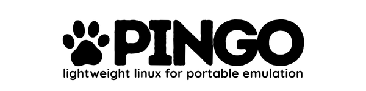
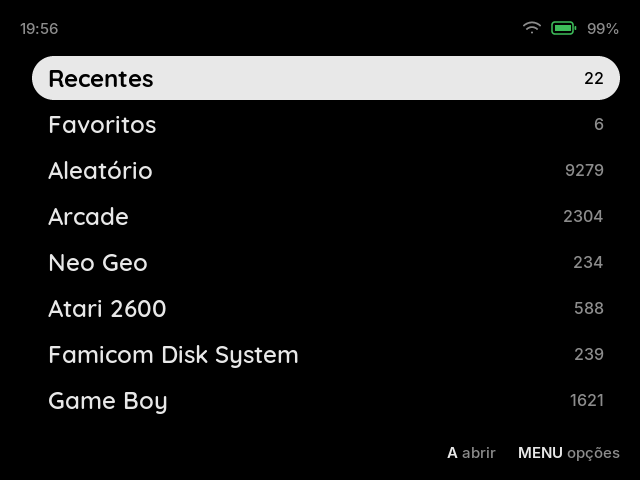
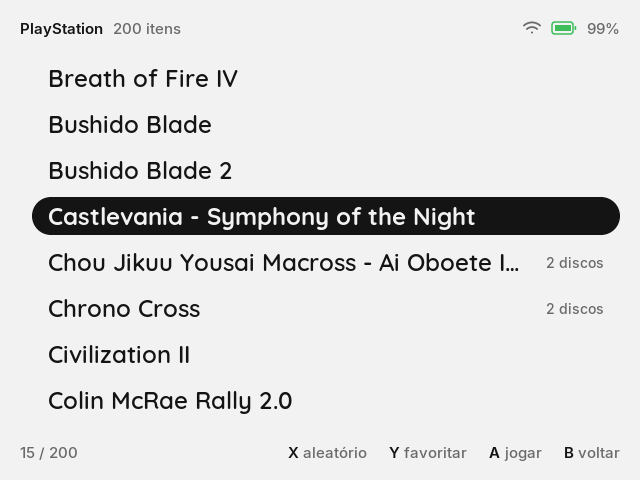
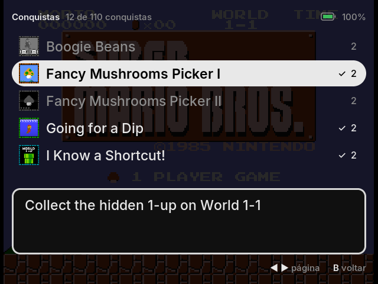

<p align="center">
  
</p>

# Pingo OS by Retrogamer Brasil

Uma distro Linux mínima para consoles portáteis retrô. Grave a `.img` no cartão SD, ligue o aparelho e jogue.

A interface segue a filosofia do MinUI: direta ao ponto, sem boxart, temas ou menus de emulador. O sistema roda em uma partição somente leitura, então um cartão corrompido se resolve gravando a imagem de novo.

<p align="center">
  
  
  
</p>
<p align="center"><sub>Início · lista de jogos · conquistas do RetroAchievements (prints do RG35XX-H)</sub></p>

> O nome vem do Pingo, o cachorro de infância do autor: curto, com cara de mascote, e representa algo pequeno.

Um projeto do [Retrogamer Brasil](https://www.retrogamer.com.br).

**Comunidade:** dúvidas, sugestões e notícias do Pingo no [Discord do Retrogamer Brasil](https://discord.gg/S3SBnaKh58).

<a href="https://discord.gg/S3SBnaKh58"></a>

Gostou do projeto? Ajude a manter o desenvolvimento:

<a href="https://www.buymeacoffee.com/wiawfsakny"></a>
[](https://ko-fi.com/E1E3O3HD6)

## Aparelhos

| Aparelho | SoC | Estado |
|---|---|---|
| Anbernic RG35XX-H | Allwinner H700 | **Beta** |
| Anbernic RG40XX-H | Allwinner H700 | Em testes (`pingo-os-rg40xxh.img`) |
| Anbernic RG40XX-V | Allwinner H700 | Planejado (mesmo SoC) |
| TrimUI Brick | Allwinner A133P | Planejado |

## O que já faz

- Início com os consoles que têm jogos, Recentes, Favoritos (Y num jogo) e Jogo aleatório (X).
- Menu dentro do jogo (MENU): 4 save states com prévia, opções por jogo ou por console, botões remapeáveis.
- Filtros de tela: cores de GB/GBC/GBA (DMG, GBC, GBA, SP 101), grade LCD, rastro e scanlines.
- Arcade (FBNeo) com o nome dos jogos, dip switches, recordes e jogos verticais em pé.
- Dois cartões: jogos no SD1, no SD2 ou nos dois juntos; um cartão do MinUI no slot 2 funciona como está.
- Suspender no botão power, voltar ao jogo onde parou, desligamento seguro.
- Wi-Fi com teclado na tela, data, hora e fuso.
- RetroAchievements: conquistas com avisos na tela, lista no menu do jogo e modo hardcore.
- Interface em português e inglês; outros idiomas por arquivo ([como traduzir](docs/traducao.md)).

Consoles: Game Boy, Game Boy Color, Game Boy Advance, NES, Famicom Disk System, Super Nintendo, Virtual Boy, Pokémon mini, Master System, Game Gear, Mega Drive, Sega CD, 32X, PC Engine, PC Engine CD, Neo Geo Pocket, WonderSwan, MSX, Atari 2600, Atari 7800, Atari Lynx, PlayStation, Arcade e Neo Geo.

## Instalação

1. Baixe a imagem do seu aparelho na página de [releases](https://github.com/luciano2000/pingo-os/releases): `pingo-os-rg35xxh.img.xz` (RG35XX-H) ou `pingo-os-rg40xxh.img.xz` (RG40XX-H).
2. Grave no cartão do slot 1 (TF1) com o [balenaEtcher](https://etcher.balena.io) ou o [Raspberry Pi Imager](https://www.raspberrypi.com/software/) (os dois aceitam o `.xz` direto). **Tudo no cartão é apagado.**
3. Ligue o aparelho. No primeiro boot, o Pingo pergunta se pode criar a partição de jogos (`ROMS`) no resto do cartão.
4. Desligue, ponha o cartão no PC e copie os jogos para `Roms/<CONSOLE>/` (as pastas já estão criadas: `GB`, `SNES`, `MD`, `PS`, `ARCADE`...). As BIOS vão em `Bios/` (veja [docs/bios.md](docs/bios.md)).
5. **Segundo cartão (opcional):** no slot 2, um cartão novo é preparado pelo Pingo (ele pergunta), e um cartão do MinUI funciona sem mudar nada. Saves e configurações ficam sempre no SD1.
6. **Wi-Fi:** MENU no Início → Wi-Fi.

Atualizar: grave a imagem nova no mesmo cartão. A partição `ROMS` (jogos, saves, configurações) é mantida.

Problemas e sugestões: [issues](https://github.com/luciano2000/pingo-os/issues) ou o [Discord](https://discord.gg/S3SBnaKh58).

## Como compilar

Requisitos: Linux, Docker e uns 30 GB livres. O build roda dentro de um contêiner Debian, então o toolchain do seu sistema não interfere.

```sh
scripts/build.sh            # RG35XX-H, imagem completa
```

As imagens saem em `output/rg35xxh/images/`: `pingo-os-rg35xxh.img` e `pingo-os-rg40xxh.img` (e `.img.xz`). Um build só gera as duas: o sistema é o mesmo, muda o device tree que a partição de boot carrega (`external/board/h700/<aparelho>/extlinux.conf`). Grave com o balenaEtcher, o Raspberry Pi Imager ou:

```sh
sudo dd if=output/rg35xxh/images/pingo-os-rg35xxh.img of=/dev/sdX bs=4M conv=fsync status=progress
```

Outros alvos do Buildroot: `scripts/build.sh rg35xxh menuconfig`, `scripts/build.sh rg35xxh linux-rebuild all`.

## Estrutura

```
docs/                  especificação, mockup da interface, notas de cada fase, BIOS (bios.md)
docker/                ambiente de build
frontend/              pingo-launcher (listas), pingo-retro (jogos, libretro) e pingo-shell
scripts/build.sh       build dentro do Docker
scripts/sync-rocknix.sh  importa patches, device trees e firmwares do ROCKNIX
external/              árvore BR2_EXTERNAL do Buildroot
  configs/             um defconfig por aparelho
  board/h700/          kernel, U-Boot, TF-A, imagem e overlay da raiz (família H700)
  package/             pacotes próprios
```

## Créditos

- [ROCKNIX](https://github.com/ROCKNIX/distribution): kernel, patches e device trees do H700 (GPL-2.0). O commit importado fica em `external/board/h700/ROCKNIX_COMMIT`.
- [rocknix-joypad](https://github.com/hackbar/rocknix-joypad): driver dos controles.
- [Buildroot](https://buildroot.org), [U-Boot](https://u-boot.org), [Trusted Firmware-A](https://www.trustedfirmware.org).
- [MinUI](https://github.com/shauninman/MinUI): referência de interface.
- [Quicksand](https://github.com/andrew-paglinawan/QuicksandFamily) (OFL-1.1): fonte das listas.
- [Inter](https://rsms.me/inter/) (OFL-1.1): fonte do resto da interface (barras, textos e dicas).
- [libretro](https://www.libretro.com): API dos cores (`libretro.h`, MIT).
- [libchdr](https://github.com/rtissera/libchdr) (BSD-3-Clause): jogos em `.chd` no RetroAchievements.
- [rcheevos](https://github.com/RetroAchievements/rcheevos) (MIT): RetroAchievements; [stb_image](https://github.com/nothings/stb) (domínio público/MIT): imagens das conquistas; [libcurl](https://curl.se) e [Mbed TLS](https://www.trustedfirmware.org/projects/mbed-tls/).
- Matrizes de cor GBA/SP 101: Pokefan531 e hunterk ([slang-shaders](https://github.com/libretro/slang-shaders), domínio público).

Cores (todos do [libretro](https://github.com/libretro)):

| Core | Consoles | Licença |
|---|---|---|
| Gambatte | Game Boy, Game Boy Color | GPL-2.0 |
| mGBA | Game Boy Advance | MPL-2.0 |
| FCEUmm | NES, Famicom Disk System | GPL-2.0 |
| Snes9x | Super Nintendo | não comercial |
| Beetle VB | Virtual Boy | GPL-2.0 |
| PokeMini | Pokémon mini | GPL-3.0 |
| Genesis Plus GX | Master System, Game Gear, Mega Drive, Sega CD | não comercial |
| PicoDrive | 32X | não comercial |
| Beetle PCE Fast | PC Engine, PC Engine CD | GPL-2.0 |
| Beetle NGP | Neo Geo Pocket | GPL-2.0 |
| Beetle WonderSwan | WonderSwan | GPL-2.0 |
| blueMSX | MSX | não comercial |
| Stella 2014 | Atari 2600 | GPL-2.0 |
| ProSystem | Atari 7800 | GPL-2.0 |
| Handy | Atari Lynx | Zlib |
| PCSX ReARMed | PlayStation | GPL-2.0 |
| FBNeo | Arcade, Neo Geo | não comercial |

## Licença

GPL-2.0. Componentes de terceiros mantêm as próprias licenças.

**Cores com licença não comercial.** Snes9x, Genesis Plus GX, PicoDrive, FBNeo e blueMSX só podem ser distribuídos sem fins lucrativos. A imagem do Pingo OS é gratuita e pode incluí-los; **vender** a imagem, cartões ou aparelhos com esses cores não é permitido pelas licenças deles.
